# clawd-fm

**English** · [Русский](README.ru.md)

[Claude FM](https://www.youtube.com/@claude/live), the lofi radio for thinking and building, playing right inside Claude Code. A band above the prompt shows Clawd in small animated scenes, the current track, and volume controls.

- **Live stream** through `mpv`, with a buffer and automatic reconnects.
- **Now playing**: the track name is read off the stream's own "now playing" plate and shown in the corner, the way the stream shows it.
- **Scenes while you listen** follow the time of day and the season, and change in turn with each track. Daytime has a meadow, a cozy room with rain on the window, rain outside, falling leaves, a train ride, skating on a frozen pond, a pier and snow. Evening and night have stars, the cozy room, a city, fireflies, a campfire, a lighthouse and a rocket ride through space. From 10 December to 14 January every other scene is festive: a New Year tree with presents, Clawd pulling a sled of gifts, and fireworks at night.
- **Scenes while Claude works** follow what it is doing. Bash shows a terminal with the command typed out. Read and Grep show a page under a magnifier. Edit and Write show Clawd building a wall. WebSearch and WebFetch show Clawd beaming signals to a planet. Agent shows a line of tiny helpers, and what subagents do shows there too, as "helper · reading notes.txt", never as Clawd's own work. When nothing else applies, Clawd is thinking.
- **Reactions**: Clawd jumps when a turn finishes and sweats when a tool fails.
- **Track list**: every track heard is saved, and `/fm list` prints them with Spotify search links.

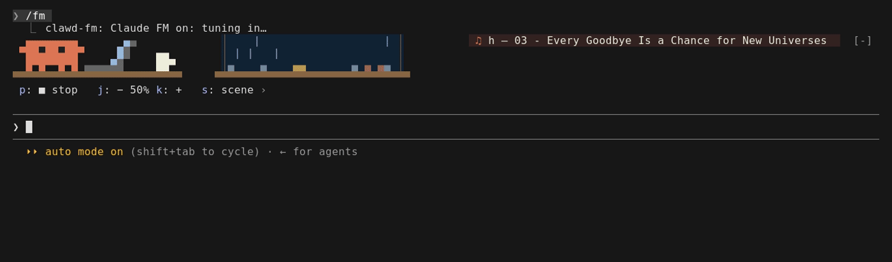

Terminal only for now: the scenes use Claude Code's pixel `Raster` element, which the desktop app does not draw.

## Scenes

The cozy room with rain on the window, shown both day and night, with the band and its controls above the prompt:

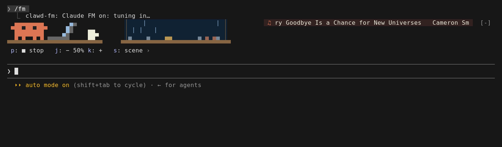

**Day** (7:00 to 20:00): a meadow, rain, falling leaves, a train ride, a pier and snow.

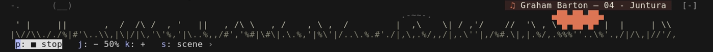
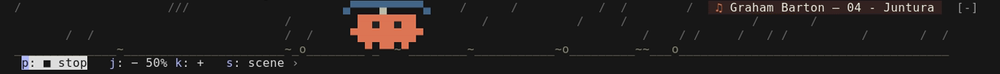
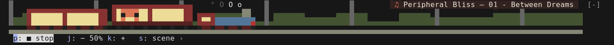
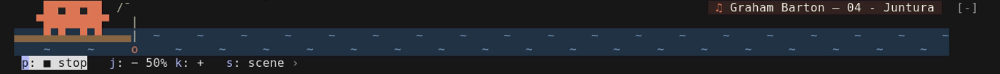
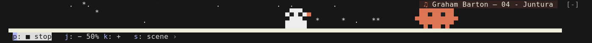

**Evening and night**: a city, fireflies, a campfire, a lighthouse, a starry night and a rocket ride.

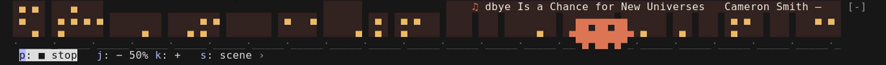
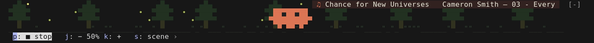
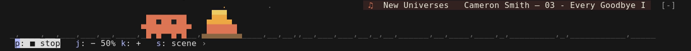
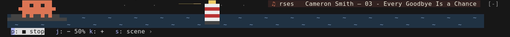
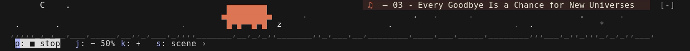
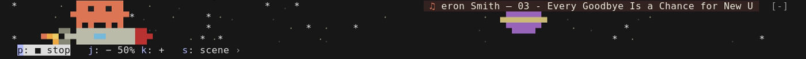

**Seasons** (northern hemisphere): the meadow shows in spring and summer, falling leaves from September to November, snow and skating from December to February, fireflies on summer nights, and rain in any month but winter's. From 10 December to 14 January the New Year tree, the sled of gifts and fireworks take every other turn. Scenes seen all year dress for the season too: the train passes white hills in winter and golden ones in autumn, snow falls past the cozy room's window and over the pier and the campfire, and flowers come up in the spring meadow.

**While Claude works**, the scene follows the tool in use, and Clawd jumps when the turn is done:

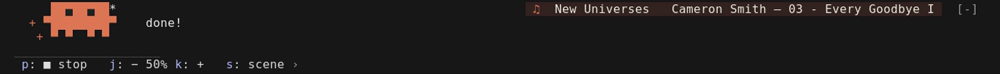

## Requirements

- Claude Code with plugin function hooks (early access API, tested on 2.1.299)
- `mpv`, `yt-dlp`, `ffmpeg`, `tesseract` (with English data), `python3`

On Arch / CachyOS:

```sh
sudo pacman -S mpv yt-dlp ffmpeg tesseract tesseract-data-eng python
```

## Install

At the prompt of a Claude Code terminal session:

```
/plugin install clawd-fm --marketplace Advnirr/clawd-fm
```

Answer `y` to add the marketplace, then pick a scope.

From a shell:

```sh
claude plugin install clawd-fm --marketplace Advnirr/clawd-fm
```

### YouTube sign-in

YouTube often answers yt-dlp with "Sign in to confirm you're not a bot", and the band then says so. If that happens, let yt-dlp borrow your browser's YouTube cookies. Run `/plugin configure clawd-fm@clawd-fm` and set **Cookies from browser**, or pass it when installing from a shell: `claude plugin install clawd-fm@clawd-fm --config cookiesFromBrowser=firefox`. The value is one of:

- `firefox`, `chrome`, `brave`, and so on, for the browser's default profile
- `firefox:/path/to/profile` for one exact profile. Firefox forks such as Zen keep their profiles in their own folders, for example `~/.config/zen/xxxx.default-release`. Write the engine's name, `firefox`, not the fork's: yt-dlp does not know `zen`, and the band says so.

The cookies are only passed to yt-dlp on your machine. They do give access to the YouTube account they belong to, so a separate browser profile signed in to YouTube only is a good idea.

## Use

| | |
|---|---|
| `/fm` | show the band and start the radio; run it again to stop and hide |
| `/fm stop` | stop the sound and keep the band |
| `/fm +`, `/fm -`, `/fm vol 70` | volume |
| `/fm scene` | next scene |
| `/fm list` | every track heard so far, with Spotify search links |

Keys: press `ctrl+x`, then `tab`, to focus the band. Then `p` plays or stops, `j` and `k` change the volume, `s` changes the scene, and `Esc` returns to the prompt. `[-]` at the band's right edge collapses it.

In several terminals at once, only one plays the stream. The others show its track with "playing in another terminal" and start no second player. Stopping in any terminal stops the radio in all of them, the volume is shared, and when the playing terminal closes, a waiting one takes over.

## Limitations

- Tested on Linux (Arch / CachyOS). macOS should work with the same tools from Homebrew, but it is untested. Windows is not supported.
- Terminal only: the desktop app does not draw the pixel scenes.
- Plugin function hooks are an early-access Claude Code API. The plugin was built on 2.1.299 and 2.1.300 and may need changes after Claude Code updates.
- The track name is read from where the stream draws its plate today. If Claude FM changes its layout, `CROP` in `bin/collect.py` and `PLATE_VF` in `hooks/register.tsx` need new coordinates.
- Playing YouTube through yt-dlp is outside what YouTube's terms of service allow. Many open-source players work this way, but use it knowing that.

## How it works

`mpv` plays the stream and, through a video filter, saves the "now playing" plate twice a second as a small image. `bin/collect.py` reads those images with `tesseract` and stitches the scrolling text back into `Artist — Title`. It takes the version it read most often, and fixes common OCR slips like `Tour1st` against a word list. That way there is only one connection to YouTube.

The plugin keeps everything it learns in `~/.local/share/clawd-fm/tracks.json`. `bin/collect.py` also runs on its own and opens the stream itself:

```sh
python3 bin/collect.py --out tracks.json --cookies-from-browser firefox
```

## Development

```sh
claude plugin validate .           # manifest and hooks module
claude plugin test .               # hooks/*.test.ts(x): scenes, /fm, the band, mpv's arguments
python3 -m unittest discover -s tests   # bin/collect.py: OCR fixes, marquee, track list
uvx ruff check bin/ tests/ && uvx ruff format --check bin/
bandit -r bin/
```

The ruff settings live in `pyproject.toml`. The `subprocess` calls in `bin/collect.py` are marked `nosec`: each passes an argv list to a program found with `shutil.which`, and none goes through a shell.

## Credits

The music on Claude FM belongs to its artists. This plugin plays the official live stream and does not copy or redistribute any audio. If you like a track, look the artist up and support them.

Tracks heard on the stream so far, as the stream's own plate names them. An artist is linked only where a catalog lists that exact track under that name; the others could not be found online yet.

| Artist | Track | Listen |
|---|---|---|
| Ardley | Dawn Hour | [Apple Music](https://music.apple.com/us/artist/ardley/252329659) |
| Astor | Blue Houses (Ft. Nate Purscelley) | [Apple Music](https://music.apple.com/us/artist/astor/1580170691) |
| Astor | Evening in Spring (Ft. Farnell Newton) | [Apple Music](https://music.apple.com/us/artist/astor/1580170691) |
| Astor | Forest Park (Ft. Farnell Newton) | [Apple Music](https://music.apple.com/us/artist/astor/1580170691) |
| Astor | Midnight Tourist | [Apple Music](https://music.apple.com/us/artist/astor/1580170691) |
| Astor | Street Lights in the Fog | [Apple Music](https://music.apple.com/us/artist/astor/1580170691) |
| Cameron Smith | Every Goodbye Is a Chance for New Universes |  |
| Chad Crouch | Shipping Lanes | [Apple Music](https://music.apple.com/us/artist/chad-crouch/19053718) · [Deezer](https://www.deezer.com/artist/2342991) |
| Cineone | Nature Guide |  |
| David Swensen | Second Sister |  |
| Fields of Ethera | Boundless Horizons C | [Apple Music](https://music.apple.com/us/artist/fields-of-ethera/1779019601) |
| Fields of Ethera | Breathe In (Lofi Edition) | [Apple Music](https://music.apple.com/us/artist/fields-of-ethera/1779019601) |
| Graham Barton | Juntura |  |
| Grapefruit | Cop Talk |  |
| Jaimie Pangan | Another Lofi Day |  |
| Jaimie Pangan | Lofi Mechanical Heartbeat |  |
| Jaybird Blonde | Subway Ride |  |
| Joey Kantor | Palmera | [Apple Music](https://music.apple.com/us/artist/joey-kantor/1555719070) |
| Joya | Oregold | [Apple Music](https://music.apple.com/us/artist/joya/82430926) · [Deezer](https://www.deezer.com/artist/133212) |
| Keen Collective | Beginnings | [Apple Music](https://music.apple.com/us/artist/keen-collective/1532380082) |
| Kolby Wade | Pianos on Grand Street |  |
| Kyle Preston | We Made It. We Finally Made It | [Apple Music](https://music.apple.com/us/artist/kyle-preston/1055457630) · [Deezer](https://www.deezer.com/artist/10455373) |
| Memory Palace | Sweetgrass | [Apple Music](https://music.apple.com/us/artist/memory-palace/1579120302) |
| Ol' Burger Beats | Ella G | [Apple Music](https://music.apple.com/us/artist/ol-burger-beats/933212664) · [Deezer](https://www.deezer.com/artist/6930641) |
| Ol' Burger Beats | Winter Night | [Apple Music](https://music.apple.com/us/artist/ol-burger-beats/933212664) · [Deezer](https://www.deezer.com/artist/6930641) |
| Peripheral Bliss | Between Dreams | [Apple Music](https://music.apple.com/us/artist/peripheral-bliss/300367124) |
| Siren and the Sea | Instinct | [Apple Music](https://music.apple.com/us/artist/siren-and-the-sea/1180251702) · [Deezer](https://www.deezer.com/artist/11440890) · [Bandcamp](https://sirenandthesea.bandcamp.com) |
| Siren and the Sea | Organ Breath | [Apple Music](https://music.apple.com/us/artist/siren-and-the-sea/1180251702) · [Deezer](https://www.deezer.com/artist/11440890) · [Bandcamp](https://sirenandthesea.bandcamp.com) |
| Siren and the Sea | The Large Floating Vessel | [Apple Music](https://music.apple.com/us/artist/siren-and-the-sea/1180251702) · [Deezer](https://www.deezer.com/artist/11440890) · [Bandcamp](https://sirenandthesea.bandcamp.com) |
| Staggering Vistas | That's The Equipment |  |

The playlist changes over time, so this list is a snapshot. Run `/fm list` to see what your copy has heard.

Claude FM and Claude are Anthropic's. This is an independent fan project, not made by or affiliated with Anthropic.

## License

The plugin's code is under the [MIT License](LICENSE). The license covers the code only, not the music or the Claude FM stream.
